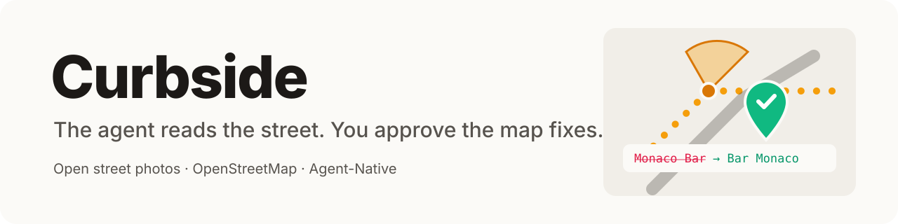
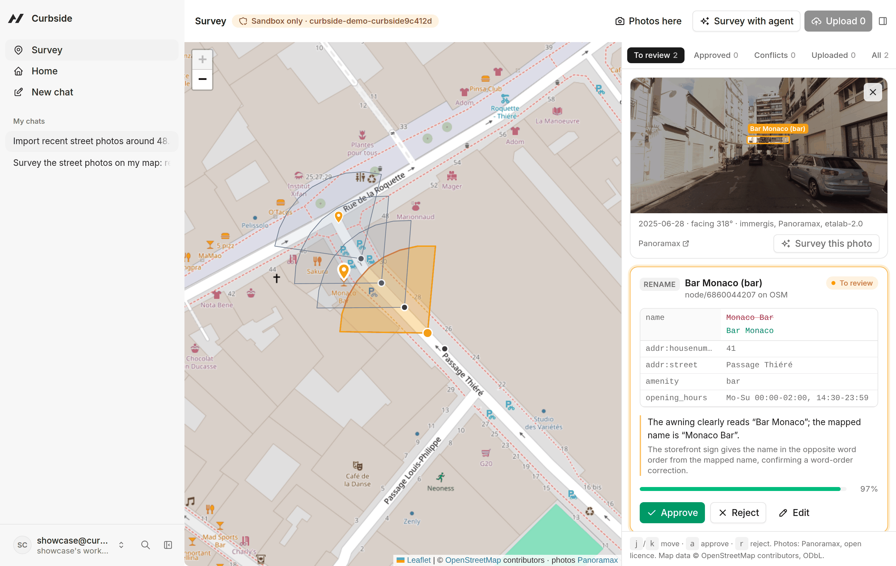
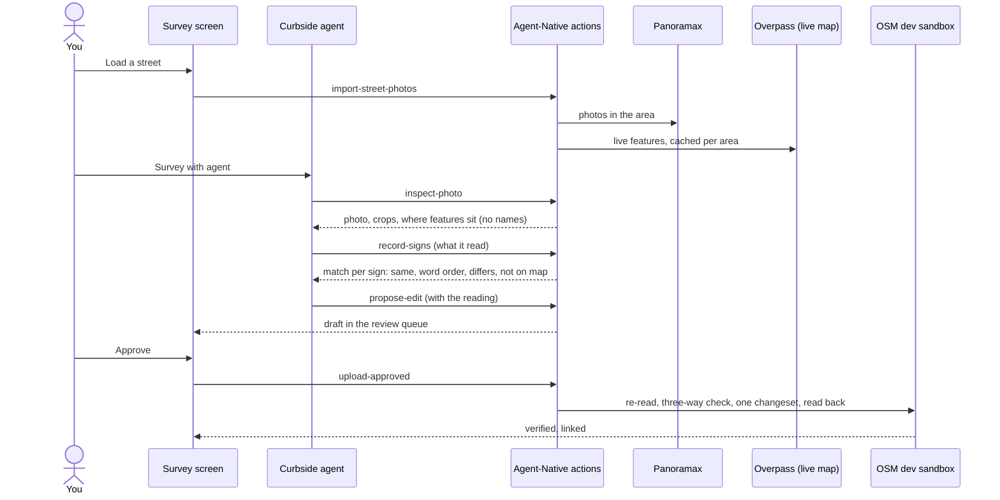
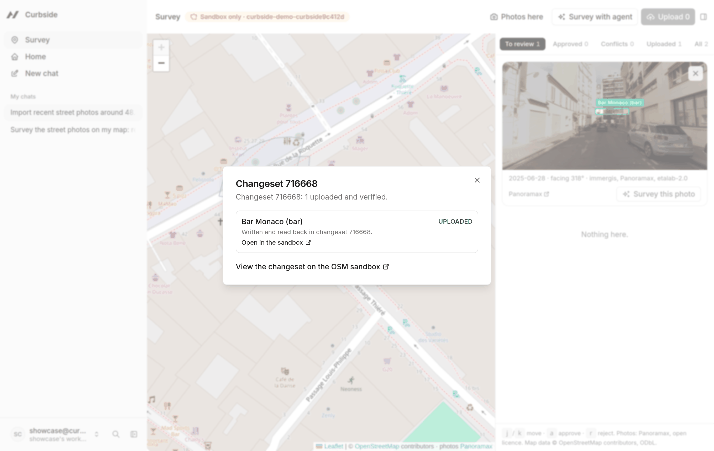
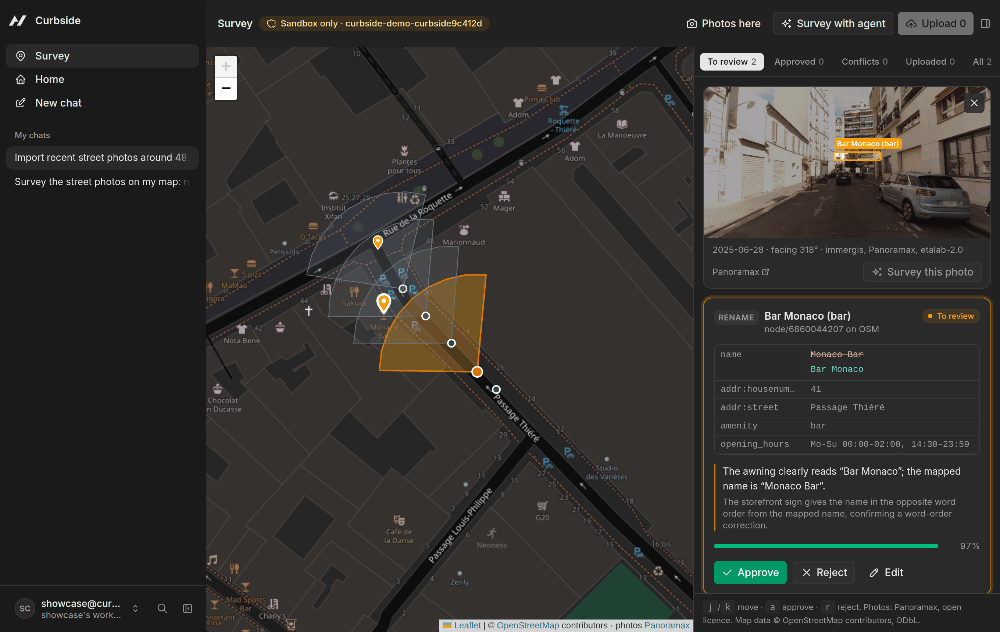
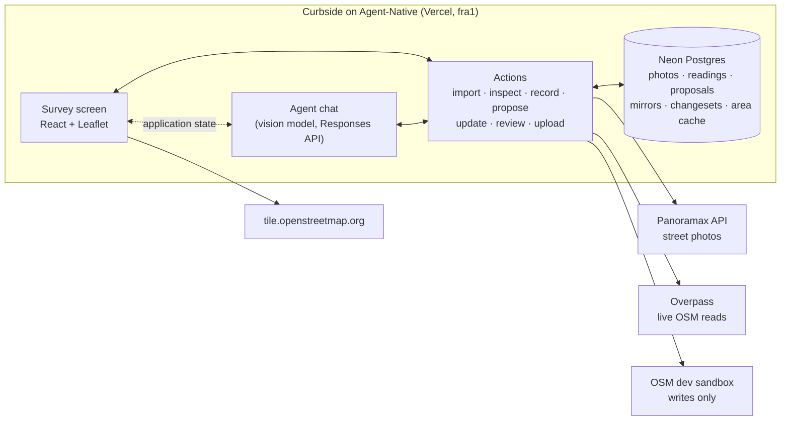

<!-- SPDX-License-Identifier: LicenseRef-zkasuran-SAND-1.0 -->
<p align="center">
  <picture>
    <source media="(prefers-color-scheme: dark)" srcset="docs/assets/banner-dark.svg">
    
  </picture>
</p>

<p align="center">
  <a href="https://curbside-map.vercel.app"><b>Live demo</b></a> ·
  <a href="https://curbside-street.vercel.app"><b>Product site</b></a> ·
  <a href="#try-it-in-60-seconds"><b>Try it</b></a> ·
  <a href="#how-it-works"><b>How it works</b></a> ·
  <a href="#built-to-be-trusted"><b>Safety</b></a> ·
  <a href="SECURITY.md"><b>Threat model</b></a> ·
  <a href="DATA-SOURCES.md"><b>Data and licences</b></a>
</p>

<p align="center">
  
  
  
  
  
  
  
</p>

---

**Curbside keeps OpenStreetMap in step with the street.** Pick a street. Curbside pulls in open street-level photos of it from Panoramax. Its agent reads every shop sign in them, **without being shown what the map says**. Only then does it compare what it read with OpenStreetMap and draft the fixes: a renamed bar, a missing shop, a place confirmed still open. You review each draft beside the photo, with the sign boxed where the agent read it, then approve or reject it. Approved edits go out in one verified changeset.

> **Why now.** Shops change faster than mappers can walk past them. AI is arriving in mapping anyway. A [2026 study](https://www.mdpi.com/2220-9964/15/5/217) warns that AI-generated features risk adding "AI slop" to OpenStreetMap. Curbside puts a person and a server-side check between the model and the map. It practises on OSM's own sandbox.

<p align="center">
  <picture>
    <source media="(prefers-color-scheme: dark)" srcset="docs/assets/hero-dark.png">
    
  </picture>
</p>

## Try it in 60 seconds

Open **[curbside-map.vercel.app](https://curbside-map.vercel.app)** and create an account (any email, no verification).

| | Do this | You will see |
|---|---|---|
| 1 | Press **Load Passage Thiéré, Paris** | Real Panoramax photos of a Paris side street appear on the map, each with its view cone |
| 2 | Press **Survey with agent** | The agent opens beside the map, looks at each photo and zooms into the shopfronts |
| 3 | Wait about two minutes | Drafts land in **To review**. Click one: the photo shows the sign boxed, the card shows the tag diff and the quote |
| 4 | Press **Approve** on the Bar Monaco rename, then **Upload 1** | A real changeset on the OSM development sandbox, written, read back and linked |
| 5 | Ask the agent "approve everything" | It can only ask. The approval waits for your click |

Keys: <kbd>j</kbd>/<kbd>k</kbd> move through the queue, <kbd>a</kbd> approves, <kbd>r</kbd> rejects.

## How it works



1. **One action, every surface.** The 12 Curbside actions are the agent's tools and the screen's API at once. The Approve button and the agent's `review-proposal` call are the same code, so they cannot drift apart.
2. **Read blind, then compare.** `inspect-photo` tells the agent where mapped places sit in the frame but not their names. The agent has to read the sign. `record-signs` matches each reading to the map on the server.
3. **The server holds the line.** A rename needs a reading that matched that same element and spells nearly the same name. A new place needs a reading that matched nothing, read again on a close-up. A misread such as "SAMIRA" for "SAKURA" is refused, with a request to zoom in and read again.
4. **An approval is a snapshot.** Before writing, Curbside re-reads the element. If anyone changed a key the edit touches, the edit stops as a conflict. Keys it does not touch are merged, so nobody's work is overwritten.
5. **Shared state, both ways.** The screen writes what you are looking at into application state, so "survey this photo" or "what's left to review?" need no ids. The agent moves your screen with `navigate`.

<table>
  <tr>
    <td width="50%"></td>
    <td width="50%"></td>
  </tr>
  <tr>
    <td><sub>One click uploads every approved draft as one changeset, then reads each element back.</sub></td>
    <td><sub>Dark theme. Map tiles are softened so the photo stays the brightest thing on screen.</sub></td>
  </tr>
</table>

## What it can fix

| The sign shows | The map has | Curbside drafts | Rule that guards it |
|---|---|---|---|
| "Bar Monaco" | "Monaco Bar" | Rename | Reading matched this element, same words in another order |
| "Sakoura" spelt slightly differently | "Sakura" | Rename | Similarity 0.8 or more, name equals the reading |
| A shop name nobody mapped | nothing nearby | New place | Reading matched nothing within 60 m, was read again on a close-up and does not sit on a mapped shopfront |
| "SAKURA" unchanged | "Sakura" | `check_date` = photo date | Never moves a newer date backwards |
| Opening hours on the door | other hours | Hours update | Re-checked against the element at upload |

## What is real and what is simulated

| Part | Status |
|---|---|
| Street photos | Real, from Panoramax, credited by producer, licence and date |
| Map data | Real OpenStreetMap, read live through Overpass |
| Sign reading | Real, by the in-app agent looking at the photos |
| Uploads | Real changesets on the **OSM development sandbox** (`master.apis.dev.openstreetmap.org`). Live OSM is never written; the client refuses any other host |
| Sandbox copies | The sandbox is nearly empty, so each live element is copied there once before its first edit, as the community's "OSM to Sandbox" script does |
| e2e proof | Uses scripted sign readings so it repeats exactly; everything else in it is live |

## Built to be trusted

| Check | Proven by |
|---|---|
| The agent cannot approve or upload | `needsApproval` on both actions; e2e: a pending edit is never uploaded |
| No rename without a matching reading | e2e: rename with no reading, with another sign's reading and with a misread all refused |
| No duplicate places | e2e: "Bar Monaco" as a new point is refused, it already exists as "Monaco Bar" |
| Near-misreads stop | e2e: "SAVANA" read where "Sakura" is mapped is held as uncertain, not added as a new bar |
| Posters are not places | e2e: text read on a mapped shopfront cannot become a new place |
| New places are read up close | e2e: a new place read only from the wide view is refused until the agent zooms in and reads it again |
| Stale approvals do not overwrite | e2e: another mapper edits the hours after review, upload holds it as a conflict, their edit survives |
| Merges keep others' work | e2e: after rebase and re-approval, the other mapper's phone number is still there |
| Retries do not write twice | e2e: re-uploading an applied edit leaves the version unchanged |
| A crash mid-upload heals | e2e: an injected crash after the write, then the next upload reconciles it from the sandbox; the place exists exactly once |
| Hostile input | 3000 random payloads per test run into every parser; XML escaping; https-only fetches with byte and time limits |

The full table of attackers, defences and tests is in **[SECURITY.md](SECURITY.md)**. One command runs the release gate:

```bash
./verify.sh          # lockfile, format, strict typecheck, Agent-Native doctor, 63 unit tests, audit, licence headers, secrets scan, build
./verify.sh --e2e    # plus the 34-check live proof against the OSM sandbox (needs pnpm dev running)
```

Latest live proof: [`docs/evidence/`](docs/evidence/), with every action call, every sandbox read and the changeset ids.

## Architecture



## Run it locally

```bash
git clone https://github.com/zkasuran/curbside && cd curbside
corepack enable && pnpm install
cp .env.example .env     # then fill in the values below
pnpm dev
```

| Variable | What it is |
|---|---|
| `OSM_SANDBOX_DEMO_TOKEN` | OAuth 2 token (`write_api`) for an account you create on `master.apis.dev.openstreetmap.org` |
| `OPENAI_API_KEY`, `OPENAI_BASE_URL`, `CURBSIDE_MODEL` | A vision model on an OpenAI-compatible endpoint with the Responses API. The agent engine is registered in `server/plugins/agent-engine.ts` |
| `AGENT_ENGINE=curbside-vision`, `AGENT_MODEL=curbside-vision` | Select that engine |
| `GOOGLE_GENERATIVE_AI_API_KEY` (optional) | Gemini as an alternative engine; it also passes photos to the model |

Users can save their own sandbox token in Settings (`OSM_SANDBOX_TOKEN`) and upload under their own name.

## What was built during the hackathon

Everything except the scaffold. On 2026-10-31 the app was created from the Agent-Native Chat template (commit `8080462`, MIT, Builder.io). Curbside added the data model, the 12 actions, the survey screen, the agent engine, the reading guard, the upload engine with conflict handling and crash recovery, the tests, the live e2e proof and these docs. [NOTICE](NOTICE) lists which template files were changed.

AI assistance was used to write this project. The design decisions, the review of the agent's behaviour and every claim in this README were checked against real runs, listed above.

## Repository layout

```
actions/                 the agent's tools and the UI's API (one file per action)
server/lib/              tags, geometry, matching, reading guard, OSM client, upload engine
server/plugins/          database migrations, agent engine, agent prompt, secrets
app/components/survey/   map, review queue, proposal card, photo viewer
tests/                   unit, property and fuzz tests
scripts/e2e-sandbox.mjs  live proof against the OSM sandbox
.agents/skills/street-survey/  the survey method the agent follows
```

## Roadmap

- [x] Blind sign reading with server-side matching
- [x] Verified uploads with conflict detection, merge and crash recovery
- [x] Per-user sandbox accounts through Settings
- [ ] "Connect OpenStreetMap" OAuth sign-in for live edits, behind a second confirmation
- [ ] Your own phone photos, uploaded to Panoramax first so the evidence stays public
- [ ] Opening hours and accessibility (ramps, steps) read from door signs

## Licence

Curbside's own code is **Source-Available No-Derivatives 1.0** (`LicenseRef-zkasuran-SAND-1.0`, see [LICENSE](LICENSE)): run it, read it, benchmark it, for any purpose. Template code keeps its MIT licence. Map data © [OpenStreetMap contributors](https://www.openstreetmap.org/copyright), ODbL. Photos © their Panoramax producers under the licence stated with each. Details in [NOTICE](NOTICE) and [DATA-SOURCES.md](DATA-SOURCES.md).
